# 📐 Specyfikacja Techniczna i Plan Wdrożenia: Silnik Adaptacyjnego Zarządzania Pozycjami (Adaptive Position Manager)

> **Status:** Gotowy do wdrożenia (Poprawiony po audycie architektonicznym `/ponytail-review`)  
> **Projekt:** Forex-SMC  
> **Moduł docelowy:** `adaptive_manager.py` + integracja z `scanner.py`, `smc_detector.py`, `trade_journal.py`, `rr_optimizer.py`

---

## 1. Cel i Zakres Architektury

Moduł odpowiada za deterministyczne, oparte na danych rynkowych i statystyce empirycznej prowadzenie otwartych pozycji (**Dynamiczny Take Profit, Adaptacyjny Break-Even, Strukturalny Trailing SL na M15 oraz Filtr Piramidowania**).

### Kluczowe poprawki względem poprzedniej koncepcji:
1. **Likwidacja cenzury danych MFE:** Wprowadzenie kontrfaktycznego badania zasięgu ceny po zamknięciu zlecenia (`counterfactual_mfe`), dzięki czemu optymalizator widzi realny potencjał rynku poza zrealizowanym sztywnym TP.
2. **Realistyczny wzór EV:** Zastąpienie wzoru binarnego symulacją uwzględniającą realne wyjścia na BE (0.0R) i Trailingu (+1.0R / +1.5R) zamiast sztucznego przypisywania straty -1.0R każdemu zawróceniu.
3. **Redukcja wymiarowości (Anti-Starvation):** Agregacja próby statystycznej do **3 globalnych reżimów rynkowych** zamiast 90 wąskich koszyków, co pozwala na natychmiastowe działanie przy bazie rzędu 25–50 zagrań.
4. **Ponowne użycie kodu (Lean):** Wykorzystanie istniejącej implementacji piramidowania w `mt5_client.py` oraz danych obliczanych na bieżąco przez `smc_detector.py` (bez dublowania zapytań do MT5).
5. **Ochrona przed błędem brokera (stops_level):** Trailing wyłącznie na interwale M15 z buforem ATR i weryfikacją minimalnego dystansu brokera.

---

## 2. Architektura Systemu

```mermaid
flowchart TD
    subgraph MarketData ["1. Pętla Skanera & SMC Detector"]
        SMC["smc_detector.py\n(H4 Trend, M15 BOS/CHoCH, ATR, Sesja)"]
        News["news_filter.py\n(Status okna News Shock)"]
    end

    subgraph RegimeLayer ["2. Klasyfikator Reżimu (MarketRegimeDetector)"]
        Regime["Wykrycie Reżimu:\n- STRONG_TREND (Ekspansja)\n- COMPRESSION (Konsolidacja)\n- HIGH_VOLATILITY (Szok/News)"]
    end

    subgraph StatsLayer ["3. Baza Danych & Empiryczna Macierz Parametrów"]
        DB[("trades.db\n(Historia transakcji + MFE/MAE)")]
        Policy["AdaptivePolicy:\n- Optymalny TP per Reżim (Symulacja EV z BE)\n- Dynamiczny próg BE (Kwantyl MAE)\n- Zgoda na Piramidowanie (Tylko STRONG_TREND)"]
    end

    subgraph ExecutionLayer ["4. Zarządzanie Pozycją w scanner.py"]
        ActivePos["scanner.py: Monitor pozycji na żywo"]
        BE["Dynamic BE: Próg dopasowany do reżimu"]
        Trail["Strukturalny Trailing SL (M15 Swing + ATR buffer)"]
        MT5Exec["mt5_client.py: Bezpieczna modyfikacja SL w MT5"]
    end

    SMC --> Regime
    News --> Regime
    Regime --> Policy
    DB --> Policy
    Policy --> ActivePos
    ActivePos --> BE
    ActivePos --> Trail
    BE --> MT5Exec
    Trail --> MT5Exec
```



---

## 3. Szczegółowe Komponenty Systemu

### A. Klasyfikator Reżimów Rynkowych (`MarketRegimeDetector`)
Klasa nie pobiera danych samodzielnie – przyjmuje gotowe wyniki z `smc_detector.py`:
- **Dane wejściowe:** `htf_trend` (H4), `recent_bos_direction` (M15), `atr_current` (M15), `atr_percentile_30d`, `is_news_window`.
- **Klasyfikacja:**
  1. **`STRONG_TREND`**:
     - Zgodność kierunku: `htf_trend == direction` oraz ostatnia struktura M15 to pro-trendowy BOS.
     - ATR w przedziale 40. do 85. percentyla (zdrowa ekspansja bez anomaliów).
     - Brak aktywnych ostrzeżeń o danych makro (`news_warn is None`).
     - *Decyzja:* Pozwala na TP z przedziału 2.5R–5.0R, wydłuża próg BE do 1.1R–1.3R (daje przestrzeni na pullback), zezwala na piramidowanie.
  2. **`COMPRESSION`**:
     - Brak zgodności trendu H4 z M15 lub ATR < 35. percentyla (niska płynność/szum).
     - *Decyzja:* Konserwatywny TP (1.8R–2.2R), szybkie zabezpieczenie BE (0.8R–0.9R), **bezwzględny zakaz piramidowania**.
  3. **`HIGH_VOLATILITY`**:
     - `is_news_window == True` lub bieżący ATR > 85. percentyla historycznego.
     - *Decyzja:* Zwiększony bufor SL, zakaz dokładek, trailing tylko z szerokim buforem $\ge 1.5 \times \text{ATR}$.

---

### B. Obliczanie Optymalnego TP i EV bez Cenzury Danych
Zamiast wzoru binarnego, `rr_optimizer.py` zostaje rozbudowany o funkcję symulacji empirycznej uwzględniającej ścieżkę zlecenia:

$$\text{EV}(R) = \frac{1}{N} \sum_{i=1}^{N} \text{Outcome}(i, R)$$

Gdzie dla każdej transakcji $i$:
- Jeśli $\text{MFE}_i \ge R \implies \text{Outcome} = +R$ (TP osiągnięte).
- Jeśli $\text{MFE}_i < R$, ale $\text{MFE}_i \ge \text{BE\_Trigger} \implies \text{Outcome} = 0.0R$ (pozycja obroniona na BE).
- Jeśli $\text{MFE}_i$ uruchomił trailing do poziomu $T \implies \text{Outcome} = +T$ (zrealizowany trailing).
- W przeciwnym razie: $\text{Outcome} = -1.0R$ (wybicie na początkowym SL).

> [!IMPORTANT]
> **Kontrfaktyczne badanie MFE dla pozycji zamkniętych na TP:**  
> W `trade_journal.py` dodana zostaje metoda `backfill_counterfactual_mfe(ticket)`: jeśli pozycja zamknęła się zyskiem na TP, bot pobiera z MT5 świece M5 przez kolejne 24h od momentu wyjścia (aż do hipotetycznego uderzenia w początkowy SL) i rejestruje `true_max_r`. Pozwala to sprawdzić, czy rynek biegł dalej do 3R, 4R czy 5R.

---

### C. Strukturalny Trailing SL (Tylko M15 + Ochrona Brokera)
Trailing aktywuje się wyłącznie, gdy transakcja osiągnie już status Break-Even ($Profit \ge +1.0R$):
1. **Źródło struktury:** Ostatni potwierdzony dołek (`Protected Swing Low`) dla BUY lub szczyt (`Protected Swing High`) dla SELL na interwale **M15** wyliczony przez `smc_detector.py`.
2. **Warunki walidacji nowego SL:**
   - Nowy SL musi być korzystniejszy niż obecny SL o co najmniej $+0.4R$ (brak spamowania zleceniami modyfikacji przy mikro-zmianach).
   - Minimalny dystans od ceny bieżącej:
     $$\text{Dystans} \ge \max(1.0 \times \text{ATR}_{M15},\; 2.5 \times \text{Broker Stops Level})$$
   - Dodatkowy bufor na spread: dla BUY odejmujemy spread, dla SELL dodajemy spread.
3. Zapobiega to całkowicie błędom MT5 `10016 (Invalid Stops)` i wybiciom na pojedynczych 5-minutowych knotach.

---

### D. Reużycie Istniejącego Piramidowania
Piramidowanie nie wymaga pisania nowej logiki. W `scanner.py:L691`:
```python
# Kwalifikacja reżimu przed dopuszczeniem skanowania piramidy
is_pyramid_allowed = (
    ENABLE_PYRAMIDING and 
    regime_detector.get_current_regime(sym) == MarketRegime.STRONG_TREND
)
pyramid_status = self.mt5_client.get_pyramid_status(sym) if is_pyramid_allowed else {"is_eligible": False}
```
Całe zarządzanie wolumenem i ryzykiem klastra nadal spoczywa na przetestowanej metodzie `mt5_client.calculate_pyramid_position_size()`.

---

## 4. Plan Wdrożenia Krok po Kroku (Roadmapa dla Następnego Chatu)

### Krok 1: Kontrfaktyczne MFE w `trade_journal.py` i `mt5_client.py`
- Dodać w tabeli `trades` kolumnę `counterfactual_max_r REAL DEFAULT 0.0`.
- Zaimplementować funkcję `update_counterfactual_mfe(ticket)`:
  - Dla zamkniętych pozycji zyskiem, sprawdza w MT5 zasięg ceny do 24h po zamknięciu lub do poziomu ceny otwarcia/SL.
  - Zapewnia to niezafałszowaną bazę do poszukiwania optymalnych celów 2.5R–5.0R.

### Krok 2: Urealnienie Symulatora w `rr_optimizer.py`
- Zaktualizować `RROptimizer.calculate_best_rr()`:
  - Przyjmuje parametr `be_trigger_r: float = 0.85`.
  - Transakcje, które nie osiągnęły testowanego $R$, ale osiągnęły próg BE, traktuje jako wynik `0.0R` (zamiast $-1.0R$).
  - Obsługuje 3 globalne reżimy rynkowe zamiast 90 koszyków:
    ```python
    def calculate_regime_rr(trades: List[Dict], regime: str) -> RROptimizerResult:
        regime_trades = [t for t in trades if t.get("regime") == regime]
        # Min próbka n >= 10 dla danego reżimu
    ```

### Krok 3: Utworzenie `adaptive_manager.py`
Stworzyć czysty, zwięzły moduł (ok. 120–150 linii):
```python
from enum import Enum
from typing import Optional, Dict

class MarketRegime(str, Enum):
    STRONG_TREND = "STRONG_TREND"
    COMPRESSION = "COMPRESSION"
    HIGH_VOLATILITY = "HIGH_VOLATILITY"

class AdaptivePositionManager:
    def __init__(self, journal, mt5_client):
        self.journal = journal
        self.mt5_client = mt5_client

    def classify_regime(self, htf_trend: str, ltf_trend: str, atr_percentile: float, is_news: bool) -> MarketRegime:
        if is_news or atr_percentile > 85.0:
            return MarketRegime.HIGH_VOLATILITY
        if htf_trend in ("BULLISH", "BEARISH") and htf_trend == ltf_trend and 40.0 <= atr_percentile <= 85.0:
            return MarketRegime.STRONG_TREND
        return MarketRegime.COMPRESSION

    def get_dynamic_be_trigger(self, regime: MarketRegime) -> float:
        if regime == MarketRegime.STRONG_TREND:
            return 1.15  # Szerszy bufor, pozwalamy na retest
        elif regime == MarketRegime.COMPRESSION:
            return 0.80  # Szybka obrona w konsolidacji
        return 0.85

    def evaluate_m15_trailing_sl(self, symbol: str, is_buy: bool, current_sl: float, m15_swing_price: float, atr: float, stops_level_points: float) -> Optional[float]:
        # Weryfikacja stops_level i minimalnego zysku
        ...
```

### Krok 4: Wpięcie do `scanner.py`
- W sekcji monitorowania otwartych pozycji (`scanner.py:L391-460`):
  - Zastąpienie sztywnego `AUTO_BE_R_TRIGGER` wartością z `adaptive_manager.get_dynamic_be_trigger(regime)`.
  - Dodanie wywołania `adaptive_manager.evaluate_m15_trailing_sl()` dla pozycji będących w zysku $\ge 1.0R$.
  - Sprawdzenie reżimu przed wywołaniem skanu piramid.

### Krok 5: Flagi w `.env` i `config.py`
```env
# ADAPTIVE POSITION MANAGEMENT
ENABLE_ADAPTIVE_MANAGER=True
ADAPTIVE_MODE=SHADOW              # 'SHADOW' (testy telemetryczne w logach) lub 'LIVE' (modyfikacja SL w MT5)
ADAPTIVE_MIN_REGIME_SAMPLES=10     # Min. 10 transakcji per reżim do aktywacji optymalizacji
ADAPTIVE_M15_TRAILING=True         # Strukturalny trailing na bazie M15 Swing
```

---

## 5. Kryteria Akceptacji (Definition of Done)

1. **Brak błędów MT5 10016:** Żadne zlecenie trailingu nie zostaje odrzucone przez brokera z powodu naruszenia `stops_level`.
2. **Poprawność matematyczna:** Test jednostkowy symulacji EV potwierdza, że pozycje cofnięte po osiągnięciu progu BE nie są liczone jako strata -1.0R.
3. **Aktywacja na realnej bazie:** Przy bazie $\ge 10$ zagrań w reżimie `STRONG_TREND`, silnik z powodzeniem proponuje zoptymalizowane TP bez wpadania w stan "brak danych".
4. **Tryb SHADOW:** W trybie `SHADOW` bot rejestruje w logach i bazie wirtualne przestawienia SL/TP bez wysyłania komend modyfikacji do MT5.
