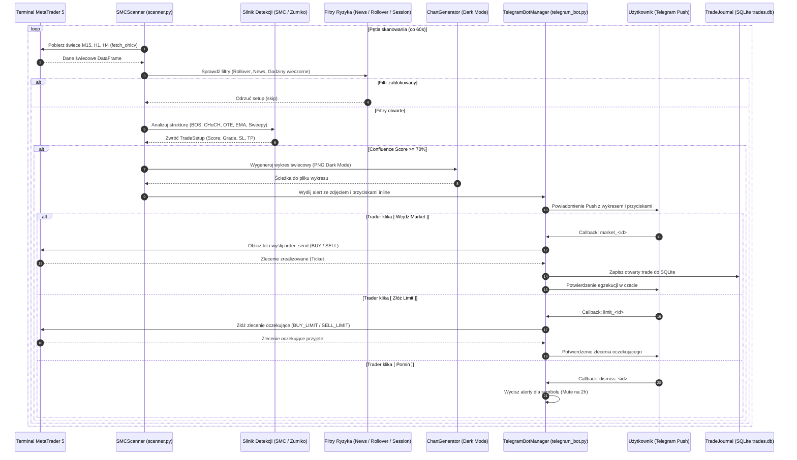
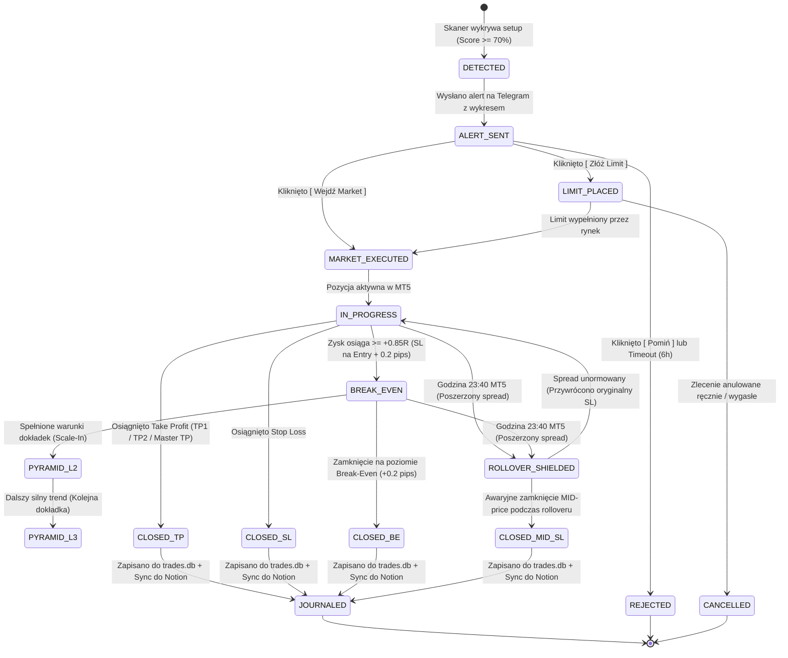
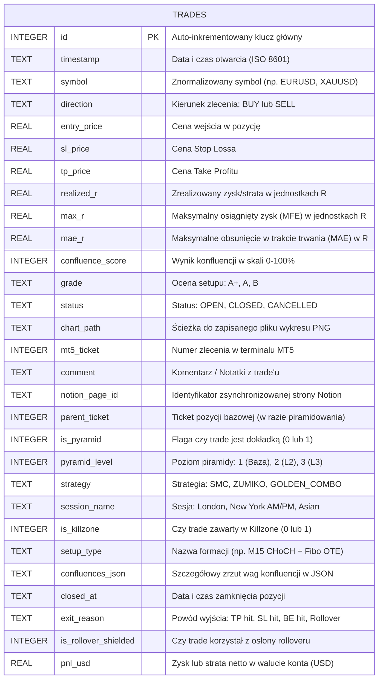
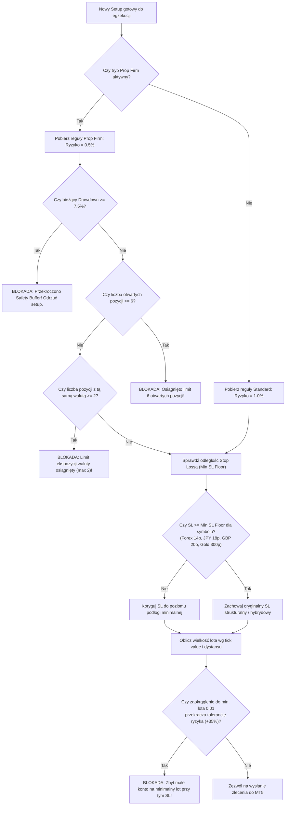

# Architektura Systemu i Diagramy Przepływu 📐

Niniejszy dokument przedstawia wizualną architekturę systemu **Forex-SMC**, relacje między modułami, cykl życia zlecenia oraz schemat przepływu danych.

---

## 1. Diagram Sekwencji: Od Detekcji Setupu do Egzekucji

Poniższy diagram ilustruje pełen obieg danych w systemie: od pobrania świec z terminala MT5, przez wielopoziomowe filtry, po wygenerowanie wykresu i interaktywne zatwierdzenie przez tradera na Telegramie.

---

## 2. Maszyna Stanów: Cykl Życia Pozycji (Trade State Machine)

Każde zagranie w systemie przechodzi przez ustrukturyzowany cykl stanów:

---

## 3. Matryca Multi-Timeframe Alignment (MTF Confluence)

System łączy trzy poziomy perspektywy rynkowej:

| Timeframe | Rola w Systemie | Wskaźniki i Obserwowane Elementy | Warunek Konieczny |
| :--- | :--- | :--- | :--- |
| **HTF (H4)** | **Nadrzędny Trend & Kontekst** | Trend strukturalny (Higher Highs / Lower Lows), Major Order Blocks | Zgodność kierunku trendu (+20% Confluence Score) |
| **MTF (H1)** | **Filtr Potwierdzenia Trendu** | Trend Zumiko KillMLM (`EMA 238`, `EMA 10/21`) | Bezwzględny wymóg: H1 musi potwierdzać kierunek dla Zumiko |
| **LTF (M15)** | **Egzekucja & Timing Wejścia** | Wybicie struktury CHoCH, Pullback Fibo OTE (61.8% - 78.6%), świeca reakcyjna, Asian Sweep | Generowanie precyzyjnych poziomów Entry, SL, TP1, TP2 |

---

## 4. Schemat Bazy Danych SQLite (`trades.db`)

Dziennik transakcji zapisuje pełną historię każdego zagrania wraz z metadanymi statystycznymi:

---

## 5. Przepływ Zarządzania Ryzykiem (Risk Flowchart)

